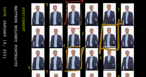

Squint ist eine mobile App, um das beste Foto aus einer Serie von Fotos auszuwählen und sich einfach mit dem Fotografen abzustimmen.

## Problem und Ziel

### Problem

In meiner langjährigen Praxis als [Business-Fotograf](http://silberblick.berlin) habe ich viele Apps und Services ausprobiert, um die Fotos meiner Shootings mit meinen Kunden abzustimmen.

  
Die drei größten Hindernisse im Business-Kontext waren:

- Anmeldung erforderlich - im Corporate Umfeld ein Sicherheitsproblem

- Bildauswahl ließ sich mengenmäßig nicht begrenzen

- zu viele Funktionen und Optionen - Kunden verschwenden kognitve Energie

<figure>

<figcaption>

Kontaktbogen, der 1:1 Print des gesamten Negativstreifen war ein Mittel der Wahl. Gezoomt wurde mit Lupe, markiert mit Stift.

</figcaption>

</figure>

### Ziel

Von der Analyse über Wireframes bis zum Prototyp methodisch die App zu testen und systematisch zu verfeinern.

## Vorgehen

### Analyse und Definition

Nach Markt- und Wettbewerbsanalyse werden die Anforderungen und Erkenntnisse als Basis für die weitere Entwicklung dokumentiert. [Sie finden das BRD auf Github](https://github.com/dkause/Squint/blob/main/BusinessRequirementDoc.md)

## Nutzer verstehen

**Typische Anwender identifizieren**  

Ein validierter Prototyp mit klarer User Experience und mobile optimierten Flow. Durch Iteration und Tests in Quant UX konnte die Task Completion Rate wesentlich verbessert werden.

## Learnings

Eine extensive Discovery Phase reduziert den Entwicklungsaufwand langfristig.  
Qualitative User Interviews auch außerhalb der Zielgruppe bringen wertvolle Usability Erkenntnisse.

## externe Links:

Das komplette Projekt finden Sie in [Englisch auf Github](https://github.com/dkause/Squint).  
Auf **Figma** [läuft der Prototyp](https://www.figma.com/proto/jAgd054xnXmdCasYTCVCAN/SQUINT?kind=&node-id=51179-5610&page-id=51179%3A5538&scaling=contain&starting-point-node-id=51179%3A5610&viewport=399%2C48%2C0.25).
