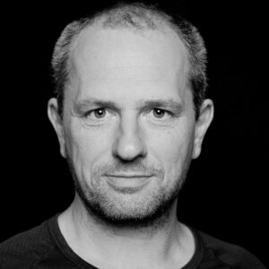

Ich bin Daniel Kause, Fotograf, UX-Designer und Full-Stack Entwickler aus Berlin.

## Biographie

- 2024: Zertifizierung **[Full Stack Developer](https://silberblick.net/zertifikate-und-titel/)**

- 2023: Zertifizierung **[UX Designer](https://silberblick.net/zertifikate-und-titel/)**

- 2005: Ausbildung einer Fotografin

- 2003: **[Meistertitel Fotograf](https://silberblick.net/zertifikate-und-titel/)** im Handwerk

- 2001 - 2020: Foto-Studio "Silberblick"

- 1971: Geboren in Berlin  
    

<figure>

<figcaption>

Daniel Kause, Fotograf und WebEntwickler

</figcaption>

</figure>

> Ich arbeite ich einfach und direkt. Klassisch, ohne Schnick-Schnack. Das ist nachhaltig, langlebig und funktioniert universell.
