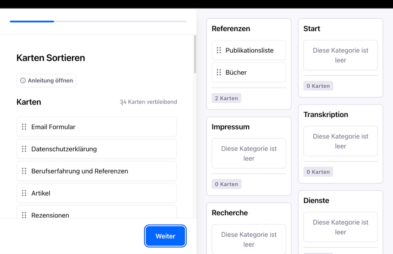
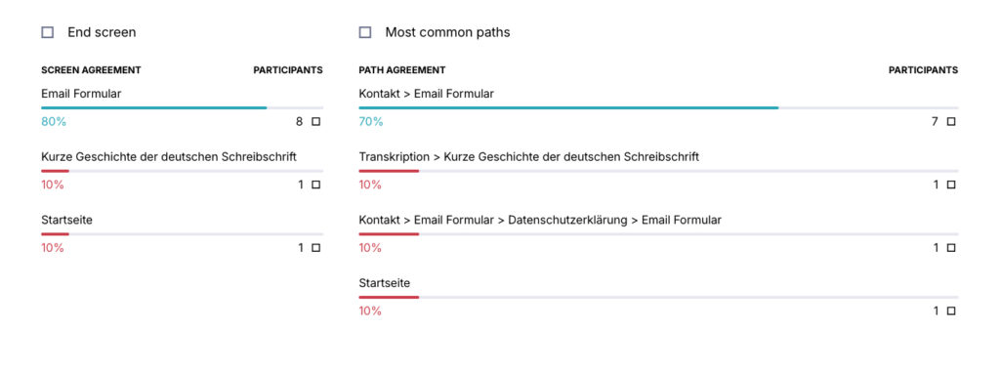

Für den Historiker Dr. David Hamann habe ich die Website "Recherche-Dienste.de" grundlegend neu aufgesetzt - von der Klärung der Zielgruppe bis zur Wahl der passenden technischen Plattform.

## Probleme

Die WordPress-Seite wurde jahrelang nicht gewartet und war nicht mehr zugänglich. Inhaltlich war vieles wertvoll, aber:

- die technische Basis war veraltet

- das Template war mobil kaum nutzbar

- Reparatur und Änderungen wären aufwendig und fehleranfällig

Gebraucht wurde eine Lösung, die zur Arbeitsweise von David passt und langfristig ohne technischen Ballast funktioniert.

## Vorarbeiten

**Vor** technischer und inhaltlicher **Umsetzung** **klären wir** mit gezielter Nutzerbefragung die Erwartungen der Nutzer an **die Informationsarchitektur** der Seite. Dafür nutzen wir **Card Sort** und **Tree Testing** mit einer kleinen Nutzerbasis von zehn Personen. Genug um qualifizierte Informationen für den Aufbau der Navigation und Inhalte zu bekommen. Und wenig genug um das kostenlose Angebot vom **[UX-Tool Maze](https://app.maze.co/)** zu nutzen.  
**Wertvolle, weil zeitsparende Informationen.**

### Card Sort

Durch den [Card Sort](https://silberblick.net/ux-design/cardsort/) lernen wir die **Zuordnung der Begriffe zu Kategorien** **durch die Nutzer.** Mit diesem Wissen können wir eine nutzer-zentrierte Navigation und Informationsarchitektur aufbauen und verstehen wie Nutzer unser Angebot wahrnehmen. **Wir vermeiden** dadurch **Betriebsblindheit** und **persönlichen Bias.**  
Qualifizierte Informationen aus dem Card Sort beschleunigen den Entwicklungsprozess erheblich und verringern die Absprungrate der Nutzer.

### Tree Testing

**Findet der Nutzer schnell das Kontakt-Formular oder die Referenzen?**  
Mit gezielten Fragen schicken wir die Nutzer auf Reise durch unsere Navigation. Ein E-Mail Formular vermutet der Nutzer oder die Nutzerin unter Kontakt, aber **wo finde ich Informationen über die deutsche Schreibschrift?**  
Unter Bücher, Transkription oder Referenzen - **Tree Testing gibt hier die Antwort.  
**  
  

## Design

- Zielgruppe 55+, Desktop-first

- Navigation ist um eine klassische Sidebar ergänzt, die mobil ausgeblendet wird

- Layout: textorientiert, Magazin-Stil

- ruhige Typografie und Farbpalette (Ocker/Sepia) kommunizieren das Fachgebiet

- klare Gliederung der Inhalte in Angebote, Referenzen und Fachgebiete

## **Umsetzung**

- Zukunftssichere WordPress- und Web-Standards

- vier WordPress Plugins für alle Features: Kontakt, SEO und Mehrsprachigkeit

- Layout passt sich fließend an die Bildschirmgröße an. Inhalte fügt David einmal über vorab definierte Blöcke ein, ohne sich um verschiedene Bildschirmgrößen kümmern zu müssen.

- Ein DSGVO-konformer, auf WordPress spezialisierter Hoster aus Deutschland sorgt für reibungslosen Betrieb.

## Ergebnis

Die Website ist wieder online und noch bevor sie komplett fertig ist, meldet sich bei David ein Kunde aus Japan. Er sucht nach Spuren seines Vaters, der im Zweiten Weltkrieg ums Leben gekommen ist. Das zeigt: Eine klare Informationsarchitektur wirkt, bevor das Design fertig ist.  
Sie lässt sich auf mobilen Geräten und am Desktop gut bedienen.  
Das Design ist zugänglich, barrierefrei und schafft Vertrauen.

David pflegt und erweitert Inhalte selbstständig, ohne große Einarbeitungszeit.
