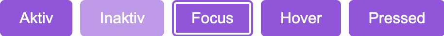

## Button-States - Interaktion kommunizieren

Buttons sind elementare Bausteine eine Website, geklickt oder gedrückt führen sie eine Handlung aus: Absenden von Formulardaten, Login oder Logout, das Absenden eine Bestellung.

Sie haben vielleicht schon einmal einen Button gedrückt und nichts ist passiert. Das ist ärgerlich und verunsichert: habe ich einen Fehler gemacht? Ist die Website kaputt?

Subtil designte Buttons informieren den Nutzer über den Zustand des Systems und setzen sinnvolle Erwartungen. Ein Button kann anzeigen wann ein Formular komplett und bereit zum Absenden ist oder ob ich eingeloggt bin oder nicht. **Mit den Buttons interagieren Mensch und Maschine - ihre States kommunizieren wichtige Informationen.**

Die meist genutzten Button States sind:

- Aktiv (Active)

- Inaktiv (Disabled)

- Hover

- Focus

- Gedrückt (Pressed)



### Aktiver Status

Aktive Buttons sind der Standard, sie indizieren die Möglichkeit der Interaktion: Formular absenden, Profil löschen, eine Aktion ausführen.  
Dieser Button sollte besonders herausstechen, besonders wenn er unser primärer CTA ist und zu unserem Konversion-Ziel führt.

Typisches Design für den **Active State** sind ein

- Starker Kontrast zum Rest des Website

- kurzes, aktivierendes Label (max. zwei Worte)

- Gut lesbar und eindeutig


### Inaktiver Status

Dieser Status signalisiert: Dieser Button ist nicht klickbar. Er ist inaktiv, das Gegenteil vom aktiven Status. In einem unvollständig ausgefülltem Formular kann der Status bis zur Vollständigkeit inaktiv sein.

Für eine gute Accessibility sollte ein inaktiver Button sollte

```
"aria-disabled="true"
```

gesetzt haben, damit Screenreader den Nutzer über seinen Zustand informieren können.

#### Typisches Design

- Ausgegrauter, leicht transparenter Hintergrund im Vergleich zum aktiven Status

- Ausgegrautes Label

- Cursor als Pfeil und nicht als Hand


### Focus Status

Der Focus Status oder keyboard-focus zeigt dem Nutzer an, welches Element den aktuellen Keyboard Focus hat. Wenn Nutzer ohne Maus mit der Tabulator durch die Website navigieren, zeigt dieser Status das aktuell gewählte Element an. Dieser Status ist wichtig, er fördert Accessibility und Usability, Browser haben eine Voreinstellung die automatisch eine blaue Umrandung erzeugt.

#### Typisches Design

- Deutlicher Rand

- Mindestens 2px für gute Sichtbarkeit

- eine kontrastreiche Farbkombination, idealerweise in den Brandfarben.


### Hover Status

Der Hover-Status reagiert auf den Cursor über dem Button und zeigt an: der Button ist klickbar. Nutzer ohne Maus (z.B. auf einen Handy oder Tablet) sehen diese Zustandsänderung nicht. Damit versehentliches Rüberfahren mit der Maus, z.B wenn der User mit der Maus quer über den Bildschirm fährt, den Nutzer nicht irritiert, empfiehlt sich eine sanfte AnimationTransition.

#### Typisches Design

- Im Vergleich zum **Active State** eine leicht dunklere Hintergrundfarbe

- Der Cursor wechselt vom Pfeil zur Hand

- Sanfte Transition

<figure>

<figcaption>

Hover-Button

</figcaption>

</figure>

### Pressed Status

Wenn der User einen Button drückt, gibt der Pressed State dem Nutzer direktes Feedback für seine Aktion. Der Nutzer weiß, die Aktion wird ausgeführt und das System hat seine Eingabe empfangen.

### Typisches Design

- Ein leichtes Abdunkeln des Hintergrund

- Eine dezente Animation des Buttons

- Verstärkt das haptische Feedback

<figure>

<figcaption>

Pressed Button

</figcaption>

</figure>

### Fazit

Buttons sind grundsätzliche User-Interface Elemente, mit denen Website und User kommunizieren. Der Nutzer erwartet Buttons, die:

- Einfach zu Lesen

- Eindeutige Funktion

- Visuelles Feedback

- Zugänglich und Barriefrei

sind.

**Besonders wichtig:** Achten Sie auf das Label, den Text. Generische und nichts-sagende Worte wie "Hier klicken", "Weiter" sind zu vermeiden.
