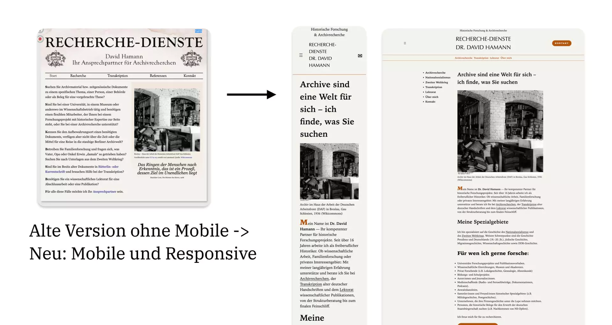
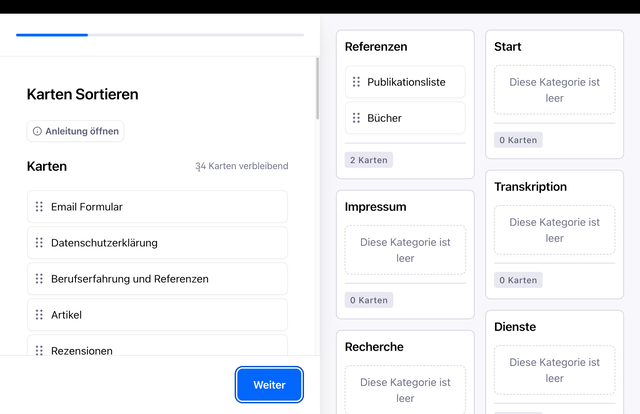
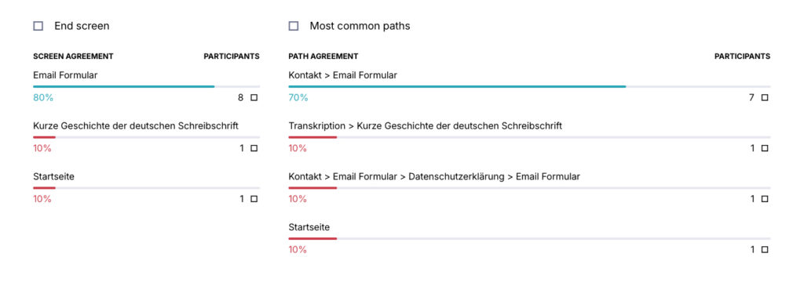

# Relaunch Recherche-Dienste.de

Mit dem Historiker Dr. David Hamann habe ich die Website neu aufgesetzt - von der Informationsarchitektur bis zur Technik.

*Passt sich an die Monitorgröße an: eigenes responsives WordPress-Template für Dr. David Hamann.*

---

## Probleme

- Die Website war nicht erreichbar
- Die WordPress-Basis veraltet
- Das Template war mobil kaum nutzbar
- WordPress ist nur Feature, kein Service des Hosters

---

## User Research

Vor Technik und Inhalt haben wir mit zehn Personen Card Sort und Tree Testing durchgeführt.

*Der Card Sort zeigt uns wie die Nutzer unsere Begriffe und Kategorien gruppieren.*

*Tree Testing: Wege zu den Inhalten.*

Die User Research liefert uns passende Labels, Kategorien und Navigationsstrukturen, diese bauen wir in die Informationsarchitektur ein.

---

## Design

- Zielgruppe 55+, Desktop-first
- Layout: textorientiert, Magazin-Stil
- klassische Sidebar, die mobil ausgeblendet wird
- ruhige Typografie und Farbpalette (Ocker/Sepia) kommunizieren Fachgebiet
- klare Gliederung

---

## Ergebnis

Schon online und noch bevor alle Inhalte mehrsprachig eingepflegt sind, generiert die Webseite Leads aus Japan.
Das Design ist zugänglich, barrierefrei und schafft Vertrauen.
David pflegt und erweitert Inhalte selbstständig, ohne große Einarbeitungszeit.
