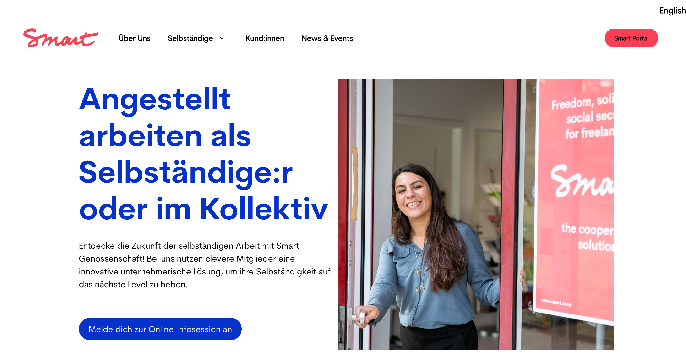
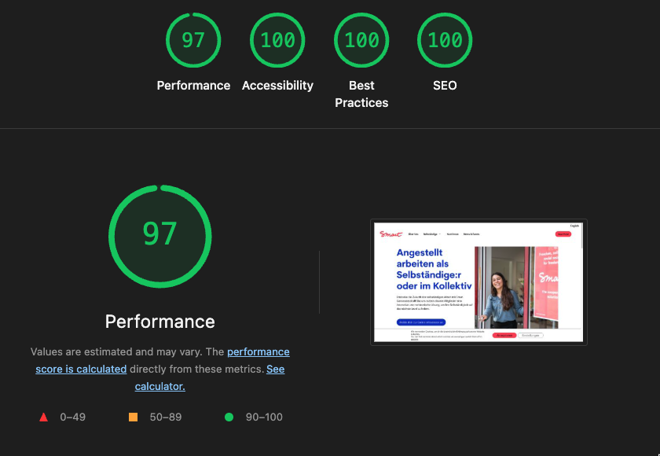

# WordPress Wartung und Updates für SMartde.coop

SMartde.coop ist die Website der Genossenschaft für Selbständige. Die Benutzererfahrung war nicht einheitlich über alle Bildschirmgrößen und es gab Fehler in der Barrierefreiheit. Das WordPress-Backend war durch viele Plugins und Pagebuilder unübersichtlich und schwer zu bedienen.

*Screenshot der Webseite von [SMartde.coop](https://smartde.coop).*

---

## Problem: Layoutfehler im Design

Das Layout passte sich nicht dynamisch an und erzeugte Overflows in der mobilen Ansicht.

## Lösung: progressive Verbesserung von Struktur und Inhalten

- Quickfix der gröbsten Fehler im Stylesheet
- Vereinheitlichung der Inhaltsstruktur
- Reduzieren von Redundanzen und Vereinfachung des Content
- Verbesserung der Informationsarchitektur

*Nebeneffekt: Die Zahl der Plugins wurde reduziert.*

---

## Probleme mit der Barrierefreiheit

SMartde.coop ist aufgrund der Unternehmensgröße verpflichtet Standards für Barrierefreiheit einzuhalten.

## Lösung:

- Verbesserung der Farbkontraste
- Klare Labels und Links
- Semantisches Html für barrierefreie Elemente

---

*Nicht perfekt - aber sehr dicht dran! Lighthouse Score Stand: 24.7.2026*
